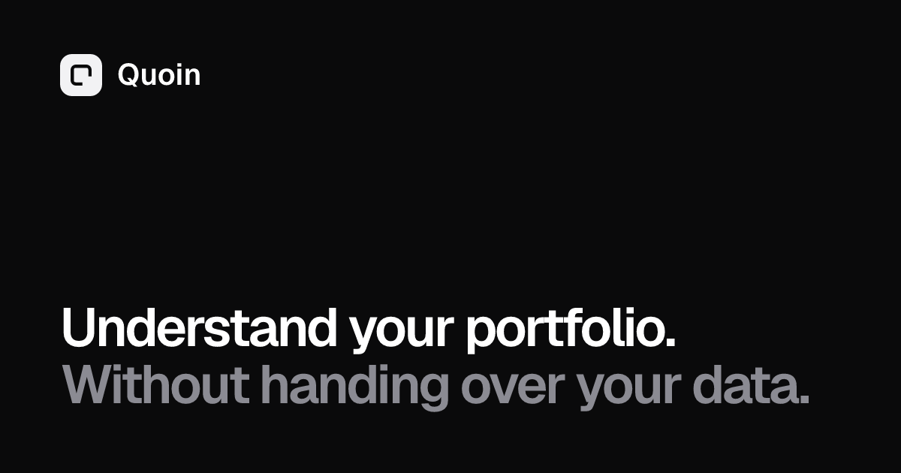

<div align="center">
  
  <h1>Quoin Website</h1>
  <p><strong>The landing page and privacy policy for <a href="https://github.com/aritzmmartinez/quoin">Quoin</a>, the portfolio tracker that keeps your data on your device.</strong></p>

[](LICENSE)
[](https://astro.build/)
[](https://tailwindcss.com/)
[](https://workers.cloudflare.com/)

<a href="https://quoin.aritzmmartinez.dev">Visit the site</a>
·
<a href="https://github.com/aritzmmartinez/quoin">Quoin app</a>
·
<a href="https://github.com/aritzmmartinez/quoin-site/issues">Report an issue</a>

<br />
<br />



</div>

---

A site about privacy should practise it. This one ships no analytics, no cookies and no third-party scripts, and its own Content Security Policy is checked on every build.

- **Static and fast.** Plain HTML from Astro. React only hydrates the few pieces that move: the floating header, the theme toggle, the language menu, the animated figures and the return chart.
- **Spanish and English.** Every page exists at `/es` and `/en`, with `hreflang`, a sitemap and per-language Open Graph images. The root picks a language from the browser.
- **Strict CSP.** Inline scripts and styles are allowed by hash only. `scripts/check-csp.mjs` fails the build if anything slips through.
- **Accessible.** Skip link, semantic landmarks, keyboard-friendly menus, light and dark themes, and `prefers-reduced-motion` respected.
- **Type-safe copy.** The English dictionary is typed as the Spanish one, so a missing translation breaks the build instead of the page.

## Getting started

You need Node.js 24 (see `.node-version`) and pnpm.

```sh
pnpm install
pnpm dev        # http://localhost:4321
```

| Command        | What it does                                                    |
| -------------- | --------------------------------------------------------------- |
| `pnpm dev`     | Dev server with hot reload                                      |
| `pnpm build`   | `astro check`, build into `dist/`, then the CSP check           |
| `pnpm preview` | Serve `dist/` (the CSP only applies here, not in dev)           |
| `pnpm lint`    | ESLint and Prettier                                             |
| `pnpm format`  | Format everything with Prettier                                 |
| `pnpm og`      | Regenerate `public/og/<locale>.png` after changing the headline |

## Where things live

```text
src/
├── i18n/es.ts, en.ts      # all page copy
├── content/privacy/       # privacy policy, one Markdown file per locale
├── components/sections/   # landing page sections
├── islands/               # the React components that hydrate
├── styles/tokens.css      # colours, copied from quoin/app/app.css
└── pages/[lang]/          # /es, /en and their /privacy pages
public/_headers            # security headers for Cloudflare
docs/design/               # reference design (Claude Design export)
```

## Deployment

The site runs on Cloudflare Workers as static assets: no Worker script and no Astro adapter. `wrangler.jsonc` uploads `./dist`, and Cloudflare builds and deploys every push to `main`, with a preview for every other branch.

<details>
<summary>One-time Cloudflare setup</summary>

1. **Connect the repo.** Workers & Pages → Create → Import a repository → pick `quoin-site`.
   - Project name: `quoin-site` (same as `name` in `wrangler.jsonc`).
   - Build command: `pnpm build`.
   - Deploy command: `npx wrangler deploy` (the default).
   - Root directory: `/`.
   - Production branch: `main`.
   - Node comes from `.node-version` and pnpm from the `packageManager` field in `package.json`.
2. **Domain.** In the Worker: Settings → Domains & Routes → Add → Custom domain → `quoin.aritzmmartinez.dev`. The zone is already on Cloudflare, so the DNS record and certificate are created automatically.
3. **Keep Web Analytics off.**
   - In the Worker's Settings, leave Web Analytics disabled.
   - In Analytics & Logs → Web Analytics, make sure `quoin.aritzmmartinez.dev` is not listed; if it is, remove it or turn off its "Automatic setup". Its injected script would be blocked by the CSP anyway.
4. **Check the first deploy.**
   - `https://quoin.aritzmmartinez.dev/` sends you to `/es` or `/en` depending on the browser language.
   - The headers from `public/_headers` arrive (`curl -I https://quoin.aritzmmartinez.dev/es`).
   - A path that doesn't exist returns the 404 page with status 404.

</details>

## Contributing

Typos, better translations and accessibility fixes are welcome. Open an issue or a pull request, and run `pnpm lint` and `pnpm build` before you push. Feature requests for the app itself belong in the [Quoin repository](https://github.com/aritzmmartinez/quoin/issues).

## License

[AGPL-3.0](LICENSE), same as Quoin.
